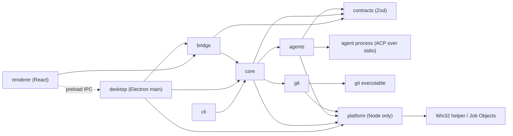

# Architecture

Status: implemented (first version). Code60 has two interfaces: the Electron desktop app and the headless `code60` command-line tool.

## What it does

`code60` runs coding agents in parallel on one Git repository. Each run gets its own worktree, so the agents cannot overwrite each other. When the agents finish, you review each worktree's diff and decide what to keep.

Git is not required to run an agent. Outside a Git repository, or in a repository with no commits yet, every run works directly in the current directory instead (see [Runs without a worktree](#runs-without-a-worktree)).

That is the whole product. The tool talks to agents over the [Agent Client Protocol](https://agentclientprotocol.com) (ACP), runs them from an Electron and React desktop app or headless from the CLI, and keeps only the plain files it needs to show what happened.

## Non-goals

These are deliberately out of scope. Add one back only when a real user needs it.

- Merging, committing, pushing, or deciding whether a task succeeded. The user does this with Git.
- Retries, durable task queues, and exactly-once execution. A failed run is reported, and the user starts a new one.
- Automatic crash recovery. After a crash, the tool lists what was left behind; recovery starts only when the user sends a new message to an ended session in the desktop app.
- Storing credentials. Agents log in through their own CLIs. The CLI passes the environment through unchanged; desktop startup enriches only PATH to discover installed tools.
- Settings profiles, workspace trust, imported project settings, and settings export. The desktop app's saved run configurations (see [Desktop app](#desktop-app)) are the one exception: named batch settings stored in the project database, never applied to the CLI or the config file.
- CLI orchestration services, external ACP servers, and arbitrary agent-to-agent communication. Only the desktop Orchestration Chat may dispatch and control its own workers in the open project through the scoped MCP tools described below.
- Agent-controlled session save and fork; steering (prompting an agent in the middle of a turn); and mid-run model changes. Follow-up prompts between turns are supported in the desktop app only. Explicit ACP restoration of ended desktop runs is described in [Ended-run recovery](#ended-run-recovery).
- Budgets, cost tracking, and usage totals.
- Workspace capacity limits, retention, and Worktrunk hooks. The read-only Worktrees tab measures logical file sizes when it is opened and in the background while it is visible, but does not enforce limits.
- File watching. The desktop app polls external state on a schedule (see [Polling](#polling)) instead.
- Shared or remote servers, and coordination across machines.
- Sandboxing. A worktree is not a security boundary, and the agent runs with the user's permissions.
- Windows ARM64 and Windows versions older than Windows 11. Windows desktop distribution targets x64 only.

## Modules

| Module | Source | Responsibility |
| --- | --- | --- |
| CLI | `src/cli` | Argument parsing, headless output, signals, and exit codes. |
| Desktop | `src/desktop` | Electron main process: the window, native dialogs, the IPC handlers, one workspace with multiple independent run batches, and shutdown. |
| Bridge | `src/bridge` | The typed IPC contract between `desktop` and `renderer`, and validation of every request from the renderer. |
| Renderer | `src/renderer` | The React interface, built with Vite. It runs sandboxed, with no Node.js or Electron access. |
| Contracts | `src/contracts` | Browser-safe Zod schemas, shared value definitions, and the prompt templates sent to agents; no application or platform dependencies. |
| Core | `src/core` | Runs, the parallel scheduler, permission policy, run records, and leftover detection. |
| Agents | `src/agents` | Starting an agent process, the ACP client, translating ACP updates into run events, cancelling, and killing the process. |
| Git | `src/git` | Creating, listing, and removing worktrees, measuring their logical file sizes, diffs, and status, using the `git` executable. |
| Platform | `src/platform` | Node-only leaf module for executable/environment resolution, owned process trees, native identity, path identity, and private storage. Uses the first-party `native/windows` helper on Windows, never an ABI-dependent addon. |



- `cli` depends only on `core`. `core` exports the event and run types the CLI and desktop app render.
- `desktop` depends on `core`, `bridge`, and `platform`. `bridge` and `renderer` may import only types from `core`; neither may import `platform`. The renderer reaches the main process only through the preload bridge. Only `desktop` imports Electron, and only `renderer` imports React.
- `agents` and `git` never import each other or `core`. `core` receives them as injected interfaces, so tests can use fakes.
- `core`, `bridge`, and `agents` may import `contracts` through its index. `contracts` imports only Zod, never application modules or Node.js. It owns shared IDs, tool kinds, stop reasons, duration rules, and the [prompt templates](#prompt-templates). Record schemas live in `core`, IPC schemas in `bridge`, and config schemas in `core`. Zod code generation is disabled before schema construction to preserve the renderer CSP.
- Domain logic lives in `core` and runs without the desktop app.
- `core`, `agents`, `git`, and `desktop` may import `platform` only through its index. `platform` imports no application modules, Electron, React, or provider SDKs. Bridge, renderer, and contracts remain browser-safe.

### Native Windows contracts

On Windows, all agent roles use a first-party helper executable outside ASAR.
It creates agents suspended, assigns them to exclusive kill-on-close Job Objects
with no breakaway, restricts inherited handles to ACP stdio, and then resumes
them. A separate authenticated control pipe and an owner-process handle stop
the job on owner/control loss. Root exit also terminates descendants. Startup
has a five-second deadline and job exit verification a five-second deadline.
ACP cancellation and its ten-second wait are unchanged. Windows then terminates
the owned job, without emulating SIGTERM. POSIX retains its existing grace.

Optional native identities contain creation time, owner SID, and agent job name.
Legacy records remain readable. Windows never authorizes a leftover stop using
command text or a PID alone. Missing, inaccessible or mismatched identities
block continuation/discard and unsafe stops; only a verified absent owned job
authorizes writing to its worktree again. Owner access failures are conservative.
Recovery remains explicit and ACP once-only permission rules are unchanged.

Windows desktop discovery reads inherited, user and machine PATH and documented
installation directories, separated with semicolons. It never runs shell profiles.
Environment names are case-insensitive on Windows; absolute executable commands
remain authoritative. Standard npm/npx shims resolve to their CLI JavaScript and
a matching Node executable. Other batch launchers use one rejecting adapter,
never blanket shell mode. Prompts stay on ACP stdin.

Browser-relative file paths remain slash-separated. Windows previews/listings
hold non-delete-sharing handles for every ancestor, reject every reparse point,
and bound reads. Local absolute drive paths are supported; device/drive-relative
paths, alternate streams and unsupported long paths fail clearly. Filesystem
identity uses canonical spelling, not globally lowercased paths. XDG/home config
and state defaults remain unchanged. New private objects receive restrictive
owner/SYSTEM ACLs at creation; existing user parent ACLs are never rewritten.
An unsafe existing Code60-private ACL fails closed. Atomic rename retries only
Windows EBUSY, asynchronously for at most 500 ms, never delete-then-write.

## A run

A run is one agent session in one new worktree (or, [without a worktree](#runs-without-a-worktree), directly in the current directory). It starts with one prompt (in the desktop app, the prompt is optional; see [Desktop app](#desktop-app)). In the desktop app, you can send follow-up prompts after each turn, and the agent keeps its context. A headless run is exactly one turn.

1. **Create the worktree.** Core creates a run ID, then, when the run has a worktree, `git` runs `git worktree add -b code60/<run-id> <path> <base>`. `<base>` defaults to `HEAD`. Worktrees go in `<repo-parent>/<repo-name>.worktrees/<run-id>` unless the config says otherwise.
2. **Start the agent.** `agents` spawns the configured command with the worktree as its working directory, in its own process group. It initializes ACP, creates a session rooted at the worktree, and sends the prompt.
3. **Stream events.** ACP session updates become run events (see [Run events](#run-events)). Core appends each event to the run's event log and forwards it to the CLI.
4. **Answer permission requests.** Core applies the [permission policy](#permissions). The desktop app may ask the user. Headless mode never waits.
5. **End the turn.** In headless mode, the turn's stop reason decides the run's final status, and `agents` stops the agent process. In the desktop app, the run becomes `idle` instead (see [Follow-up turns](#follow-up-turns)).
6. **Review.** `code60 diff <run-id>` shows the worktree's changes against `<base>`, including untracked files and any commits the agent made. The user keeps the work by committing or merging with Git, or removes it with `discard`.

The tool advertises no ACP file-system or terminal client capabilities. Agents use their own tools inside the worktree, and permission requests are the only point where the tool approves anything.

If an agent requires ACP authentication, the run fails with a message telling the user to log in through that agent's own CLI.

### Runs without a worktree

When the current directory is not inside a Git repository (or `git` is missing), or `HEAD` resolves to no commit because the repository has none yet, the runs have no worktree. The agent starts directly in the current directory, and nothing is created, initialized, or committed for it.

- The CLI says so on standard error before the runs start. With more than one run, it warns that the runs share the directory and can overwrite each other's changes.
- `--base` still requires a commit and is a usage error (exit code 2) when it cannot be resolved.
- The record has `base` and `branch` set to `null`, and `worktree` is the directory the agent ran in. `--json` reports `"branch": null` and `"changedFiles": null`.
- `diff` and `discard` refuse (exit code 1), because there is no separate worktree or branch. Review and undo the changes in the directory itself. `list` and `stop` work as usual.

### Run statuses

| Status | Meaning |
| --- | --- |
| `queued` | Waiting for a free slot under the parallel limit. |
| `running` | The agent is working. |
| `waiting` | A permission request is waiting for the user (desktop app only). |
| `idle` | A turn ended, and the agent is waiting for a follow-up prompt or for you to finish the run (desktop app only). The agent process stays alive. |
| `finished` | The last turn ended normally (`end_turn`). This is not a check that the task succeeded. |
| `failed` | The worktree or agent failed to start, the agent exited, ACP failed, or the last turn stopped for any reason other than `end_turn` or `cancelled`. The reason is recorded. |
| `cancelled` | The last turn was cancelled by the user, or the process received SIGINT or SIGTERM. |
| `timed_out` | The last turn exceeded the turn timeout. |
| `interrupted` | Found after a crash: the run was active, but the process that owned it is gone. |

### Parallelism

`run` accepts several agents. Each `--agent` flag creates one run, and the same agent may be named more than once. When only one agent is named (or none, meaning the default agent), `--parallel <n>` starts `n` runs of it, all at once, up to 32. With several `--agent` flags, `--parallel` instead overrides `maxParallel` for that invocation. Core keeps an in-memory queue and starts runs up to `maxParallel` (default 4). An `idle` run keeps its slot, because its agent process is still alive; finish it to free the slot. A failed run does not affect the others. Nothing is queued across process restarts.

Two `code60` processes can work on the same repository at the same time. Run IDs, branches, worktree paths, and record directories are all unique per run, so the processes never write to the same files.

The desktop app can also run multiple independent batches in the current project. Each batch has its own orchestrator and selected parallel limit, not a project-wide limit. New sessions do not inherit earlier sessions' ACP context or worktree changes; each isolated worktree starts from its selected base revision. Without worktrees, sessions necessarily share the folder's changes.

### Follow-up turns

In the desktop app, a turn that ends for any reason other than an agent exit or ACP failure moves the run to `idle`. From `idle` you can:

- **Reply.** Type a prompt and send it. Core sends it as a new `session/prompt` on the same session, and the run returns to `running`. A new prompt is sent only after the previous turn has ended.
- **Finish.** End the run. `agents` stops the agent process, and the last turn's stop reason sets the final status, using the same rules as headless mode.

Core never reads an agent's message to decide whether it asked a question. You read it and decide whether to reply. An `idle` run has no timeout. Quitting the desktop app finishes every `idle` run.

### Ended-run recovery

Recovery is explicit and desktop-only. It never starts automatically after a crash. Sending a new message from the chat composer continues any ended run (`finished`, `failed`, `cancelled`, `timed_out`, or `interrupted`) in the open workspace. Resume in the actions menu or command palette only opens the chat and focuses its composer; it starts no agent. Queued, running, and waiting runs are already active; an `idle` run already has a live session that accepts replies. Continuation is disabled while the ended run's recorded agent process group is alive, or after its worktree was deleted. The user must stop a leftover process before trying again; core checks the process group again before starting a writer.

When the record has an ACP session ID, sending the message launches the configured agent in the existing worktree and initializes ACP. It calls `session/resume` when advertised, otherwise `session/load` when advertised. Transcript updates replayed by `session/load` are suppressed because the append-only event log already contains them. A successful restore keeps the run ID, branch, worktree, and history, records a reconnection note, and sends only the new message, without resending any prior prompt.

If the record has no ACP session ID, the agent does not advertise restore, or ACP restoration fails, the same send action starts a fresh ACP session in the same worktree without a confirmation modal. Code60 builds a deterministic handoff summary of at most 12,000 characters from the `handoffSummary` [prompt template](#prompt-templates) from saved prompts, agent messages, tool-call summaries, and run state. It tells the new agent to inspect the worktree and verify completed work instead of blindly repeating prior requests. The first ACP prompt combines that summary and the user's new message. The transcript records only the new message as a prompt, and records the reason for the handoff as a note with an expandable Handoff summary. A failed agent start leaves the previous status unchanged. Handoff reuses the existing run record, branch, worktree, and event log; it creates no replacement run or worktree.

### Cancellation and timeouts

The turn timeout (`turnTimeout`, default 30 minutes) applies to each turn, not to the time a run spends `idle`.

Cancelling a turn, whether by the Cancel turn command (context menu or command palette) or timeout, sends ACP `session/cancel` and waits up to 10 seconds for the turn to end. In the desktop app, a turn that ends within that time leaves the run `idle`, so you can reply or finish. In headless mode, or when the turn does not end in time, the run ends: the agent's process group gets SIGTERM, followed by SIGKILL after 5 seconds. Killing the whole group also stops the tool processes the agent started. The worktree is always kept.

On SIGINT or SIGTERM, the CLI cancels every active turn and ends every run. It waits for the agents to stop and exits with code 130. The desktop app does the same on these signals, then quits. A second signal skips the grace periods.

## Permissions

ACP permission requests carry a tool-call kind: `read`, `edit`, `delete`, `move`, `search`, `execute`, `think`, `fetch`, `switch_mode`, or `other`. A request with a missing or unknown kind is treated as `other`. The policy maps each kind to `allow`, `deny`, or `ask`:

```json
{ "read": "allow", "search": "allow", "think": "allow", "edit": "allow", "default": "ask" }
```

- `ask` prompts in the desktop app. In headless mode, `ask` means deny.
- `--allow <kind>` (repeatable) and `--allow-all` override the policy for one invocation.
- Core picks the agent's "once" option when allowing (`allow_once`) and when denying (`reject_once`). It never picks the "always" options, so the agent keeps no lasting grant. If the agent offers no matching "once" option, the request is answered as cancelled.
- Every decision is recorded as a `permission` event, with who decided it (`policy` or `user`) and the options offered by the agent.

## Run events

```ts
type RunEvent = { runId: string; at: string } & (
  | { type: "status"; status: RunStatus; reason?: string; turn?: number; completedAt?: string }
  | { type: "prompt"; turn: number; text: string; origin?: "automatic" }
  | { type: "note"; text: string; detail?: string }     // Reconnection or handoff explanation
  | { type: "message"; text: string }
  | { type: "thought"; text: string }
  | { type: "toolCall"; toolCallId: string; title: string; kind: string; status: string }
  | { type: "permission"; toolCallId: string; title: string; kind: string;
      decision: "allowed" | "denied"; by: "policy" | "user";
      options?: { optionId: string; name: string; kind: string }[] }
  | { type: "turnEnd"; turn: number; stopReason: StopReason;
      completedAt?: string; outcome?: "finished" | "cancelled" | "timed_out" | "failed" | "interrupted" }
  | { type: "acp"; update: string; payload: string; size: number; truncated?: true }
  | { type: "stderr"; text: string }   // Written once when the run ends: the last 64 KiB of stderr
);
```

Every ACP session update is recorded as a raw `acp` event, including updates that also produce typed events and updates the tool does not understand (plans, usage, modes, non-text content, tool inputs/outputs, and other provider fields). `update` is the ACP update name, `payload` is its JSON text, and `size` is its original UTF-8 byte count. Payload text is capped at 256 KiB per update, clipped at a complete UTF-8 code point with `truncated: true`; clipped payloads are not necessarily valid JSON. Unrecognized updates are never treated as errors or approvals. Raw and typed updates replayed by `session/load` are suppressed to avoid duplicating history. Each completed ACP prompt response records its turn number and stop reason as `turnEnd`; transport failures instead retain the run's failure status/reason.

## Files

Project run records live inside the repository's Git directory, so they travel with the repository. The desktop orchestration conversation instead keeps its records in `.code60_workspace/<chat-folder>/.code60/runs` beside the connected database. Outside a Git repository, they live in `$XDG_STATE_HOME/code60/dirs/<key>/runs/` (default `~/.local/state`), where `<key>` is the first 16 hex digits of the SHA-256 of the directory's absolute path. `list` and the other commands look in the same place for the directory they run in.

```text
<git-common-dir>/code60/runs/<run-id>/
  run.json       Run record: status, agent, first prompt, turn count, base, branch, worktree, PIDs,
                 the agent's command line, times, last stop reason, and when it was discarded
  events.jsonl   Append-only run events, for display and review
```

- `run.json` is replaced atomically (written to a temporary file, then renamed). `events.jsonl` is append-only.
- Records and events are validated when read, including agreement with the requested run ID. Malformed records are omitted from listings; directly reading a malformed record or event log reports an error without including its contents. Unknown metadata fields are ignored, and older records without optional recovery fields remain readable. Event readers skip unknown string event types after checking their run ID; known types still require valid fields. Older releases reject logs containing `acp` or `turnEnd`, so this run-record change requires a major release.
- Both files are created with mode `0600`. The event log can contain anything the agent printed, so it is treated as sensitive. It never leaves the machine.
- Raw ACP updates preserve provider content as well as the typed display events, so logs grow faster and may contain sensitive tool inputs and outputs. The 256 KiB raw-payload cap applies per update, not per log; no total-size limit or retention policy is enforced. Stderr remains only the last 64 KiB, written when the run ends.
- The first prompt is stored in `run.json` so `list` can show it. `run.json` also stores the optional ACP session ID for desktop recovery; older records without it remain readable. Every prompt, including follow-ups, is a `prompt` event in `events.jsonl`. Logs on standard error never include prompts.
- These files are records, not a recovery mechanism. If they are lost, only history is lost.

Configuration is one JSON file at `$XDG_CONFIG_HOME/code60/config.json` (default `~/.config/code60/config.json`). It is read-only to the tool; the user edits it.

```json
{
  "defaultAgent": "claude",
  "maxParallel": 4,
  "turnTimeout": "30m",
  "worktreeDir": null,
  "permissions": { "read": "allow", "search": "allow", "think": "allow", "edit": "allow", "default": "ask" },
  "agents": {
    "claude":   { "command": ["npx", "-y", "@agentclientprotocol/claude-agent-acp"] },
    "codex":    { "command": ["npx", "-y", "@agentclientprotocol/codex-acp"] },
    "opencode": { "command": ["opencode", "acp"] },
    "droid":    { "command": ["droid", "exec", "--output-format", "acp"] }
  },
  "prompts": {
    "handoffTurn": "{{summary}}\n\nThe user's new message follows. Check the worktree first, then respond to it.\n\n{{message}}"
  }
}
```

Every key is optional. `permissions`, `agents`, and `prompts` are merged over the defaults shown above, one kind, agent, or template at a time. Unknown keys (including inside agent definitions) and invalid values are a configuration error (exit code 2). Durations use the same grammar in CLI configuration and saved desktop configurations, and must total a positive safe integer number of milliseconds.

The model is part of an agent's command or of the agent's own configuration. The tool does not pick models.

### Prompt templates

Every prompt text that Code60 writes itself, rather than passing through from the user, is a template in `src/contracts/prompts.ts`. A template marks merge fields as `{{name}}` (spaces inside the braces are allowed). `prompts` in `config.json` may replace any template by its ID. The `operatingContract` is injected before each user message in the orchestration chat; its text is not recorded as if the user wrote it. ACP v1 has no stable system-prompt field, so this context is included in the prompt sent to the selected provider.

The orchestration chat uses the connected database's saved Operating Contract edit first, then `config.json`, then the built-in template, on each new turn. Desktop handoffs resolve each template the same way; edits apply only to later handoffs, never a turn already in progress. Edits are shared by every project in that database. The CLI does not read database edits and never sends these templates.

| Template | Sent | Merge fields |
| --- | --- | --- |
| `handoffSummary` | The summary of an ended run for a fresh handoff session, truncated to 12,000 characters after merging. | `status`, `turns`, `agent`, `branch` and `base` (`none` without a worktree), `worktree`, `reason` (`none` when not recorded), `prompts` (one `- ` line each), `messages` (one line each), `toolCalls` (`- title (kind, status)` for the latest state of each call); lists are `(none)` when empty |
| `handoffTurn` | The first prompt of a handoff session. | `summary` (the merged `handoffSummary`), `message` (the user's new message, required) |
| `operatingContract` | Prepended to each user turn in the app-wide orchestration chat. | none |
| `workerUpdates` | Automatic worker turn-end and failure updates, delivered between orchestration chat turns. | `updates` (required; worker states and bounded reply excerpts) |

- A template is at most 8,000 characters and not empty. An unknown or malformed merge field, an unknown template ID, or a missing required field is a configuration error (exit code 2).
- Merging is one pass: values are inserted as they are, never escaped and never scanned for further merge fields. Saved prompts and agent output are untrusted text inside the prompt.
- Automatic orchestration turns also receive the Operating Contract, with an explicit automatic-update heading. Their prompt events carry `origin: "automatic"`; older/user prompt events omit it. Saved Operating Contract edits are preserved, with a warning when they retain the old prohibition against controlling runs.
- The CLI's own prompts are exactly the user's text, so headless runs use no template.

## Leftovers after a crash

`run.json` records the PID of the owning `code60` process and of the agent's process group. When the tool starts, and whenever you run `list`:

- A run that was `queued`, `running`, `waiting`, or `idle` when its owning process disappeared is marked `interrupted`.
- If the agent process for an ended run still exists, `list` says so and shows its command line.
- `stop <run-id>` kills that process group, but only after confirming that the live process's command line still matches the recorded one, which guards against reused PIDs. The recorded command line is what `ps` reported right after the agent started, because launchers such as `npx` change how their command line looks. If it does not match, the tool refuses and prints the PID so the user can decide.
- Worktrees are never removed automatically.
- In the desktop app, an ended run with its worktree intact may be continued by sending a message after its leftover agent is stopped. It attempts ACP restoration first, then starts a handoff if needed as described above. This is not automatic crash recovery.

## CLI

```text
code60 run [prompt] [--prompt-file <path>] [--agent <name>]... [--base <rev>]
           [--turn-timeout <duration>] [--parallel <n>] [--allow <kind>]... [--allow-all]
           [--headless] [--json]
code60 list [--json]
code60 diff <run-id>
code60 discard <run-id> [--yes]
code60 stop <run-id>
code60 --version
```

- `run` is always headless and runs exactly one turn per run. It reads the prompt from the argument, `--prompt-file`, or standard input, and exactly one of them must be given. Standard input is read only when neither of the others is given and it is not a TTY. `--headless` is accepted for compatibility and changes nothing. Use the desktop app for interactive runs.
- In headless mode, progress goes to standard error: status changes, new tool calls, and permission decisions. `--json` writes one result object to standard output, `{"runs": [...]}`, with every run's ID, agent, status, reason, branch, worktree, and changed-file count. Without `--json`, a short table goes to standard output.
- `discard` refuses while the run is active or its agent process is alive. It shows the files that would be lost, then removes the worktree and its `code60/<run-id>` branch. It asks for confirmation in a TTY and requires `--yes` otherwise.

### Exit codes

When runs end with different statuses, the code earliest in this table wins:

| Code | Meaning |
| --- | --- |
| 2 | Invalid usage or configuration, including an unknown run ID. |
| 130 | Cancelled by a signal, or at least one run was cancelled by the user. |
| 124 | At least one run timed out. |
| 1 | At least one run failed or was interrupted. |
| 0 | Every run finished. |

## Desktop app

The Code60 desktop app is the interactive interface. It is a standalone Electron app with a React interface. `npm run dev` builds and starts it, rebuilding on changes; `npm start` starts the built app. It is not packaged or signed in this version.

- **Orchestration Chat.** Chat is the default page after the splash and renderer reload, and the first alphabetical sidebar entry. Once a database and configured orchestration provider are available, the main process automatically creates an initial fresh ACP session in a generated UUID subfolder of `.code60_workspace` beside the database. **New chat** creates and selects another independent session; the expandable Chat group in the primary sidebar switches conversations without stopping background turns. New chat and labelled conversation buttons are nested beneath Chat, with selection, activity and failure indicators. Expansion is remembered, external navigation reveals the selected conversation, and collapse never changes it. Each chat has its own working directory, transcript, draft, scroll position, worker ownership, authenticated gateway and automatic-update inbox. New directories use mode `0700`; existing folders and legacy workspace contents are retained, with no Git initialization or branch creation. Sessions start idle without a prompt and use the fixed allow-all, once-only permission policy. They stay alive across page and project switches; changing databases, provider, or its configured command ends all chats and starts a fresh conversation. Renderer reloads reuse all main-process sessions and the selected conversation, never creating another. Conversations are independent of project batches, tables and search. Run and event records live privately in `.code60_workspace/<chat-folder>/.code60/runs`, outside SQLite; each app launch starts fresh, retaining previous folders on disk without automatically restoring them. The empty conversation shows a larger Code60 wordmark above New conversation; the header retains only the provider and connection controls. The page presents user messages on the right and streamed replies on the left; thoughts, tools, permissions and session notes remain available in expandable Activity disclosures. Errors stay visible. A persistent composer has a 24px upper-right chamfer with a compact, centered viridian (`#40826d`) drop shadow in Light and yellow (`--primary`) drop shadow in Dark and System dark only while focus is inside the composer. Its border stays transparent and its ordinary focus outline is suppressed to avoid a solid frame or layout shifts; forced colors use system outlines while focused because shadows are suppressed. It shows explicit Connecting, Thinking, Working, Responding and Stopping states with a 12px striped loading line inside the composer’s top border that respects reduced motion. Each connecting, working, waiting or stopping chat also has a matching activity line in its primary-sidebar entry, including background conversations. Its composer activity line also includes current-project workers owned by that conversation, supplied by main-process snapshots, even when automatic worker updates are paused. This aggregate indicator never changes orchestrator sendability or Stop semantics. Enter sends, Shift+Enter inserts a newline, Stop cancels that chat's turn, and failed/stopped sessions offer Retry, which replaces only that conversation. The main process validates every action against an existing chat run ID; stale requests cannot target replacement sessions. Paths are generated only in the main process, never supplied by the renderer or agents. Existing core startup and turn timeouts, permission handling, cancellation and process-group cleanup apply. Stop all and every shutdown path stop every chat; quitting warns when any chat is starting or working, and idle orchestrators alone do not trigger a confirmation. Each chat's draft survives switching conversations, pages and renderer reloads for the current run. Initial database connection is available from Chat when needed.

- **Orchestration provider.** Settings selects one configured agent, or None, for Orchestration Chat and its worker tools. The app-wide provider name is saved in `desktop.json`, separate from batch settings and the read-only agent config. Allow all actions without asking is fixed on for this role; ordinary run permission settings remain independent. An unavailable saved name remains visible rather than silently selecting another provider. Test connection starts the configured process, initializes ACP, creates a session in the connected database's sibling `.code60_workspace`, and stops the process group without sending a prompt, creating a run/worktree, or recording a transcript. The probe uses the existing ACP client, advertises no filesystem/terminal capabilities, and answers permission requests with the once-only allow policy. Connection status is transient. Tests are single-flight, time out after 15 seconds (plus process termination grace), and support cancellation. Changing databases or the selected provider/command cancels a pending probe; shutdown waits for cleanup. Authentication and transport failures appear in Settings.

- **Visual system.** Light uses white surfaces throughout, including resting controls, table headers and rows, code blocks, disabled controls, and the footer. Fine borders separate fields, buttons and sections; existing restrained shadows distinguish groups and overlays. Hover uses pale viridian fills without adding borders; selection uses neutral gray. Teal primary actions remain. Dark and System dark mirror the white-surface treatment with dark steel-gray (`#242b33`) resting surfaces throughout, including table headers and every row. Main text is white, muted text is `#aaaaaa`, subtle borders are `#414b56`, control borders are `#888888`, and selection uses `#323c46`. Fine borders separate controls and fields; disabled stripes are transparent. Existing gold actions, green hover fills, colored messages, focus colors, and opt-in status signals remain. The sidebar and main page surfaces have no outer border and retain 5px corners; other passive containers are square. The D-DIN Regular Code60 logo has a small 45-degree chamfer at the upper-right of its colored 60 block. Standalone buttons, including navigation, use 5px corners. Inputs, checkbox marks, scrollbars and passive containers stay square. The Focus highlight border appearance switch controls focus outlines and their glow app-wide, including composite prompt editors and composers; it defaults off, applies immediately, and persists locally as `code60.focusHighlight`. When enabled, outlines follow control geometry; explicit selection, validation, approval and failure cues remain. Standalone buttons have no trailing-edge border effect. Related controls form seamless groups with a 5px radius at the two outer ends and straight internal separators, with no overlapping hit areas. A fine outer border and restrained shadow distinguish control groups; their fill is white in Light and steel-gray in Dark. Standard groups use 28px controls (30px including the frame); compact groups use 24px controls. Menus, dialogs, chat windows, the palette and toasts use restrained overlay shadows. Icons remain locally bundled 16px IBM Carbon glyphs in DOM and canvas. Six configurable text roles retain their independent choices. Status labels and symbols carry meaning with optional signal colors; nothing blinks. Reduced motion disables functional animation; forced colors retain visible control edges and selection. Scrollbars use subtle theme-relative thumbs and a stronger hover tone app-wide; forced colors retain native contrast. No decorative dots or middle-dot delimiters are added outside the explicitly requested dotted preview frame.
- **Overlays.** Buttons with an accessible label or a `data-tooltip` show an inverted tooltip after a 500ms hover, or at once on keyboard focus or a quick move from another tooltip; Escape hides it. Tooltips prefer to sit above their control with a 2px stem pointing at it, flip below near the top edge, appear beside menus for menu items, and show shortcuts (from `data-tooltip-keys`) at the right. Unavailable menu items and buttons explain why in their tooltip. Cmd+K (Ctrl+K) opens a command palette, unless a dialog is open. An empty query lists every command in groups: Pages (Chat, File Explorer, and the remaining page tabs, including Prompt Editor and Settings), Project (New agent session, Open project, Connect to database, Poll project data, Stop all runs), Appearance (each theme, Signal colors, and Inline charts, with checkmarks on the current choices), and Session (commands for the selected session). Typing switches to one ranked list: label prefixes first, then word starts, then substrings, then matches in the group or run context, with matched letters bold and underlined. Arrow keys move, Enter runs, Escape closes and restores focus, and the footer counts the results. Unavailable commands are listed but disabled, following the same rules as the buttons they mirror. Right-clicking a session row, pressing the Context Menu key or Shift+F10 on the grid, or activating its Actions cell opens the same actions menu: Open chat and Review changes; Cancel turn, Finish run, Resume, and Stop leftover agent; and Delete worktree last under a 2px rule. Actions menus never have title strips. Items have Carbon icons; unavailable items keep their place, hatched, and say why in a tooltip. Arrow keys, Home, End, and typing a letter move between items; Escape or Tab closes the menu and restores focus, while an outside click, resizing, or window blur closes it without moving focus. Resume is unavailable while the recorded process group is alive or the worktree was deleted; it only opens the chat and focuses the composer. Toasts appear 16px from the window's bottom-left corner, newest at the bottom, at most three (a fourth displaces the oldest). Each has a Carbon icon, a written tone, and a 3px left rule: Note (4 seconds), Done (6 seconds), Warning (8 seconds), and Error (stays until dismissed or displaced). A bottom bar shows the time remaining; hover or focus pauses it, and the dismiss button or Escape closes a focused toast. Notes, Done, and Warning are announced politely; errors use `role="alert"`. Approvals stay in place until handled.
- **Splash.** At launch, the window shows the Code60 wordmark in D-DIN Regular, with 60 set in a theme-colored block with a small upper-right, 45-degree chamfer, centered in the window. The same chamfered wordmark appears in Search and empty Chat views, with enough right padding to keep the numerals legible. A saved, available orchestration provider is required before entry. If it is missing or unavailable, Set orchestration provider opens automatically as a modal popup using the same controls as Settings, including fixed allow-all and the ACP test. Done stays disabled until a provider is saved; cancelling, closing, or pressing Escape leaves the splash in place with a Set orchestration provider button. A successful ACP test is optional and requires a connected database as in Settings. After configuration, halfway between the wordmark and the bottom, `Continue <project name>?` offers a primary Yes button to open the last project and No (or Escape) to leave it closed. There is no card, folder path, or timestamp. Without a previous project, a primary Start button enters the app. The splash waits for the wordmark's font and for an answer. Renderer reloads skip it only after a valid provider is checked; a stale session-storage marker or already open project cannot bypass missing-provider setup.
- **Database.** Edit > Database Connection… in the native application menu, or Connect to database on the start screen, opens a Select database dialog to open an existing SQLite file or create a new one with the native file pickers. The database stores the history of opened project folders (canonical path and last-opened time), saved run configurations, and prompt template edits; run records stay where they are. New databases use schema 3. Schema 1 and 2 databases are upgraded in place in one transaction by adding the prompt-template table; schema 1 also gets the run-configuration table. Opening projects requires a connection. The app remembers the selected database in `$XDG_STATE_HOME/code60/desktop.json` and reconnects on launch; a saved database that is missing or unusable is reported, never recreated. Only empty files and Code60 databases are accepted, and other databases are never modified. Switching databases requires every run to have ended and closes the open project.
- **Workspace.** File > Open Project… in the native application menu (Cmd+O or Ctrl+O) is enabled while a database is connected and no batch is active. Open Project shows a dialog with the connected database's project history, newest first. Choosing an entry opens that folder; Create new project picks an existing folder with the native folder picker, without creating files or initializing Git. Each opened folder is recorded once. Remove takes one project out of the history, and Clear history removes them all after a confirmation; neither touches the folders or their runs. A folder that no longer exists is reported and stays in the history. Run records are found the same way as for the CLI, so the app shows the folder's earlier runs as history. Switching projects requires every run to have ended.
- **Run batches.** The sessions table's New agent session add row (see [Tables](#tables)), or New agent session in the command palette, starts one batch with an optional first prompt, one or more agents (the same agent may repeat), a parallel count with the same meaning as `--parallel`, and advanced options for the base revision, turn timeout, and per-kind permission overrides. Validation and defaults are the same as for `run`. Additional independent batches can start while earlier sessions are running, waiting for approval, or idle. Parallel limits apply per batch. The controller tracks each batch and its subscriptions, routes actions and approvals to its owner, and combines snapshots and sequenced events without clearing earlier transcripts. Completion history reads are serialized with starts and refreshes so overlapping batches cannot overwrite newer history or a switched workspace. Project and database switches stay blocked until all batches have ended; Stop all and every shutdown path stop all batches, including forced shutdown. Without a first prompt, each run goes straight to `idle` ("no prompt yet"), and the first prompt you send becomes turn 1 and the run's first prompt. Finishing a run that never got a prompt gives `finished` with the reason "no prompt was sent".
- **Database workspace directory.** Whenever the desktop app successfully opens or reconnects to a Code60 SQLite database, it creates `.code60_workspace` in the database file’s parent directory if missing, using private directory permissions. Existing contents are preserved. This includes startup reconnection and databases selected after launch. A file conflict or filesystem error follows the existing database connection error path.
- **Episodic Memory experiment.** Experiments → Episodic Memory extracts important details from the open project's recorded events with the configured orchestration provider. A **Maximum events** field beside the centered extraction button accepts a whole number from 1 to 10,000, defaults to 10,000, and remembers the last valid value locally. The cap follows the existing session order and takes each session’s earliest recorded events until reached; a larger limit processes all available events. The button count reflects the capped selection. Invalid limits disable extraction, and the limit cannot change during a run. Clear retains both the prompt and the limit. The **Extract from N events** button captures the displayed per-session event counts, waits for complete transcript reads, and displays each returned natural-language statement as a separate cloud, with softly rounded edges, two subtle lobes, and a continuous contrasting outline around the filled shape. Clouds flow side by side and wrap onto new rows with a 35ch maximum width, 28px vertical/32px horizontal padding, and text at least 16px. Light mode uses a diagonal white-to-light-blue fill and dark text. Dark mode uses the gradient only in a thick 4px outline, with a transparent interior and the normal foreground text color. The silhouette keeps fixed-size lobes as text grows; forced-colors mode uses system colors and a plain outline. Completion reports the end-to-end elapsed time measured with a monotonic clock, including startup and cleanup; Clear and a new extraction reset the timing status. **Edit prompt** opens an inline editor; edits persist locally, **Reset prompt** restores the default instructions, and **Clear** removes results and status while retaining the prompt. Results remain in memory across page switches and reset on project/database changes or renderer reload. Extraction may be rerun with a revised prompt. Empty input, unavailable providers, incomplete reads, invalid responses, and errors are explicit; failed or cancelled runs do not publish partial results.
  - The main process validates the request ID, project directory, session membership, prompt size (8,000 characters), and event counts. It reads the selected event prefixes itself, including live events not yet written to disk; later events are left for the next extraction. A request supports up to 10,000 events and 1,000,000 serialized characters, with explicit errors rather than silent truncation. Core divides input into excerpts of at most 32,000 characters and uses one fresh ACP session per excerpt, validates JSON statements, and deduplicates identical text ignoring case and repeated whitespace. Responses are bounded to 64,000 characters and 500 statements per excerpt, 2,000 characters per statement, and 2,000 combined statements.
  - Extraction is single-flight, has a five-minute deadline, and runs in a temporary directory with no Code60 MCP server. Its fixed prompt treats event text as data and prohibits tool use; permission requests are denied. This uses the existing agent process model, not a sandbox. It does not add project runs, feed the orchestration Chat, or save extracted statements. The process group is stopped and the temporary directory removed on completion or failure. **Cancel extraction**, Stop all, project/database/provider changes, and shutdown cancel outstanding work; stale cancellation IDs cannot stop another extraction. The two fixed preload methods use the ordinary sender checks and strict bridge validation.

- **Prompt Editor.** A permanent sidebar page lists the handoff templates, worker-update template and Operating Contract, with each effective source (Saved edit, config.json, or Built-in). Each template has a monospace editor, a merge-field dropdown when fields exist, inline validation, and a live preview with fixed sample values, never real run data. The page also documents each MCP tool, distinguishes read-only tools from worker mutations, and explains the shared tool contract. Invalid templates cannot be saved. Unsaved drafts are kept per template through page switches; Discard changes restores the effective text. Save stores an edit in the connected database. Reset to default confirms before removing the saved edit and restores the config.json template, or the built-in template when no config override exists; its tooltip names that source. The page offers Connect to database when disconnected. Saved edits load on connection and with the run-configurations poll; invalid or unknown saved templates are skipped with a warning.
- **Run configurations.** A permanent Configurations tab shows a table like the sessions table with Name, Preset Provider (every distinct agent in the configuration), # Agents (sessions the configuration creates), Uses, and Last Used (local time, or Never). Its New run configuration add row opens the run configuration editor; it is unavailable while another action is in progress. An Actions column after Name works like the sessions table's: clicking its cell, or pressing Enter on it, opens a menu with Edit and Delete for that configuration; deleting asks for confirmation and never affects sessions. A configuration holds the batch settings from the run form (agents, parallel count, base revision, turn timeout, and permission overrides), never a task prompt or project path. Names are unique within the database, ignoring case, and configurations are shared by every project in it. When saved, a missing parallel count or turn timeout is filled in from the current defaults; an empty base revision stays empty, so the configuration also works without Git. New agent session first lists the configurations and a Do not use a run configuration option. Choosing a configuration opens the run form prefilled with its settings and an empty prompt; changes apply only to that batch. Back returns to the list and keeps the draft. A batch counts as one use of its configuration once it has started; declined and invalid starts do not count. After a batch starts, a confirmation reports how many sessions started and has an unchecked Save Run Configuration checkbox. Checking it shows a name field, and saving stores the batch's settings as a new configuration with one use, without starting agents again. Each batch can be saved once; a failed save can be retried.
- **Runs without a worktree.** Before such a batch starts, a native dialog says the agents work directly in the folder. It warns that they can overwrite each other's changes when several new runs share it or existing live sessions already use it. Declining starts no new agents and leaves existing sessions untouched. Diff and discard are disabled for these runs.
- **Tables.** The Sessions, Messages, Events, Configurations, Worktrees, and Polling tables share one Glide Data Grid component and its built-in interactions. Each grid has a page title on the left and one right-aligned, joined button group containing Search, Filters (and Unapply when active), Columns, Settings, and any table-wide actions. The area behind the group is transparent; there is no separate toolbar above it. Search, or Cmd+F (Ctrl+F) while that table's page is visible and no dialog is open, opens Glide's search overlay for that table only; Escape closes it and returns focus to the grid. Each column heading except Actions has a Glide header menu (also reachable from the Column picker by keyboard) with Sort ascending, Sort descending, and a filter. Text columns offer Contains, Is, Is not, Is empty, and Is present; category columns such as Agent and Status choose Is or Is not from the column's values; number and date columns add At least and At most (on or after and on or before for dates). Filters on several columns combine with AND. While column filters apply, their Clear buttons and Clear all filters join the same table control group; a compact status below reports N of M rows. Ad hoc column filters are kept in memory for the open database and project only, and reset when either changes; Polling result rows always stay under their source. The Settings button opens a labelled native modal dialog for that table: Row density, Row lines, Column lines, Heading lines, Fit columns to width, Visible columns (at least one stays visible), Inline charts on the sessions table, and Reset to defaults. The modal uses an 880px maximum width, 32px viewport margins, fixed header/footer, and a scrollable body. Its four-row Glide preview uses fictional sample data with the current table's headings, order and widths, shared typography and theme, and sample Sessions charts. Draft edits update only the preview until Apply; Cancel, Escape and the close button discard them and return focus to the trigger. Reset changes the draft to inherited defaults; Apply then removes the saved override unless the user edits the reset draft. Turning off charts preserves at least one ordinary visible column. Workspace/table replacement discards an open draft. The preview has an orange dotted outer frame and a plain Preview heading. Visible columns lives in a closed-by-default dropdown above it; Escape closes the dropdown before the modal, and outside clicks or moving focus outside the dropdown dismiss it. Display settings use two columns of On/Off toggles with no row dividers, stacking only on very small windows. Column visibility also uses toggles. The preview has no editing, sorting, resizing, or row actions. Column widths from resizing and the column order from dragging headings are saved with these choices by stable column ID, per table, in local storage under `code60.tableView.v1:<table>`; a table without saved choices follows the Settings page's Table defaults. Legacy session-filter storage is preserved; the new named-filter workflow uses its own versioned schema. The sessions and run configuration tables end with Glide's sticky, tinted add row (New agent session and New run configuration); activating it opens the existing creation form and never creates a row inline. A labelled button with the same name, visible on keyboard focus, does the same, and both are disabled under the same conditions. Selection stays with the row's ID through sorting, filtering, and data updates.
- **Named filters.** Every existing table has a Named filters dialog for creating, inspecting, editing, deleting, applying and unapplying a definition. Conditions use stable column IDs and typed comparisons with Match all/any, including relative minutes for date columns. A preview counts matching parent rows after ad hoc column filters. Only one named filter is active per table and it intersects with existing column filters; edits apply immediately, unapply removes only its effect, and deletion clears its selection. Versioned local storage scopes definitions and selection to table plus database/project (Polling uses the database). Unknown columns/types/operators/versions are explained and never silently rewritten. Malformed libraries are retained until the user explicitly resets them.
- **Consolidated Search.** Search starts with the Code60 wordmark above a centered, 560px-wide field. Entering a query animates the field into the full results layout and reveals Type and Sort controls; clearing the query returns to the start view. Reduced motion skips the transition. Search and its palette command cover only the current project: identity, run metadata, prompts, messages and thoughts, including historical transcripts and streamed chunks. All query terms must match case-insensitively. Title matches rank ahead of content, exact identifiers get a boost, and recency breaks ties; Newest sorting and type filtering are explicit choices. Text-only highlights and a context preview accompany keyboard-selectable results. Opening a run opens chat; conversation matches reveal and focus their original event block; a project match selects Sessions.
- **Shared transcripts.** Search, Messages and Events share a renderer-owned cache for each database/project. Reads use the existing validated `events` action, run at most four concurrently, deduplicate in-flight/cached requests and invalidate changed run versions. Project switches dispose the old cache and stop queued reads; late results cannot publish into the new project. Loading, per-run partial failures, retry and empty states are visible. Live events supersede cached history. No CLI or IPC capability is added.

- **Sessions table and chat.** A Glide Data Grid table fills the window. There is no app header. Stop leftover agent and Stop all runs (while a batch is active) join the shared table control group; refresh is in the application footer polling widget. Rows are numbered on the left, with white backgrounds in Light and steel-gray backgrounds in Dark; clicking a row number opens that session's chat like any other cell. Sortable, resizable columns show Agent, Actions, Status (including discarded runs), Turns, Approvals (blank at zero), ID (last six characters), PID (the agent's process group, blank before the agent starts), Branch (`none` without a worktree), and Started (local time). Clicking a session's Actions cell, or pressing Enter on it, opens the actions menu described under Overlays instead of the chat. Sorted columns show a Carbon arrow in the heading. Newest sessions appear first by default. Status is text, not only color: the Status column draws each state's 16px Carbon icon and 12px label in a 128px slot, following the emphasis rules under Visual system. With Inline charts on (the default), three more columns draw on the canvas from the run's recorded events: Turn time (a line of the last six completed turns, prompt to turn end, with the latest duration), Events, 5 min (bars for ten 30-second buckets of non-status events, with the total), and Last 2 min (a strip of state spans, solid while working and hatched while awaiting approval). Each column shares one scale across rows (at least 0 to 20 seconds and 0 to 8 events); a run without samples shows Unavailable rather than zero, and the cells' text gives the same values in words. The charts redraw on the chart ticker, every five seconds by default (see [Polling](#polling)), and only while the Sessions tab and window are visible. Context usage, ratings, tags, and owners are not shown, since Code60 does not record them. The application footer polling widget shows an eye icon and scoped agent-message age above its Pause/Start and Refresh buttons. Search, column filters, and table settings work as described under Tables. Click a row, or press Enter on the focused cell, to select the session and open its chat. A 40px application footer (growing with enlarged text) spans the entire window bottom with a clear top border and a steel-gray Dark background; the eye icon and agent-message age sit just above that border, with polling controls on the left and a chat dock on the right that stays visible and interactive on every page, with right-aligned chat heads, one per docked session showing its agent, ID, status, and waiting approvals. Each chat head exactly matches the app footer's outer height and top/bottom edges, whether open or minimized. In Dark and System dark mode, each expanded head uses the neutral selected fill (`#323c46`) with white text. Opening a head expands it to the chat's width (up to 400px); the chat extends directly above it (480px default maximum height, growing for enlarged text and constrained by the viewport), with matching edges and no gap. Its square silhouette and subtle drop shadow separate it from the grid; vertical separators distinguish each footer entry, and popup windows have a fine neutral frame. The transcript uses the chat surface, the header uses the secondary surface, and the composer has a filled, square input shell. These surfaces follow Light, Dark, and System without rounded corners; overlays share restrained shadows. Several chats can stay open side by side, each with its own transcript, draft, scroll position, loading state, and errors. Clicking a chat head opens or minimizes only that chat. The header has separate Minimize and Close controls: Minimize hides the popup but keeps its head; Close removes both without cancelling the turn or finishing the run. Clicking the session's table row reopens a closed chat. Live sessions get heads automatically, but a closed head stays closed until explicitly reopened. Starting or automatically discovering sessions adds every dock entry minimized, including the first session and reconstruction after renderer reload. Only explicit navigation opens a popup. The dock scrolls horizontally when the heads and popups exceed the available width, with left/right scroll buttons when needed. Drag the six-dot handle at the left of a chat to reorder it; dragging the chat label never reorders it. A drop indicator marks the position, and dragging near either edge scrolls the dock. Escape or dropping outside cancels the move. Alt+Left/Right on a focused head reorders it by keyboard, with a screen-reader announcement. Dock order and open/minimized/closed state are in memory only and reset on renderer reload or workspace switch. The chat shows prompts, streamed messages, thoughts, tool calls, permission decisions, and the agent's stderr tail, without speaker, turn, or status labels; its header shows the agent, ID, and status label, and the chat head shows the status. Agent text is rendered as plain text, never as HTML. Ended runs show their recorded `events.jsonl`.
- **Controls.** The composer sends a prompt to an `idle` run or continues an ended run with ACP restoration or a fresh handoff (Enter sends, Shift+Enter adds a new line; no shortcut hint is shown). Ended runs say that sending a message resumes the session. Deleted worktrees show an inactive message instead of the composer; other blockers explain why sending is unavailable. Recovery notes appear in the transcript, with an expandable Handoff summary for fresh sessions. The chat header has Full screen, Minimize, and Close controls. Full screen expands that same chat into an overlay inset 8px within the main content area, preserving its draft, transcript, approvals, and loading state. Exit full screen or Escape restores its docked view; clicking outside or switching pages also dismisses the overlay. Minimize and Close keep their existing meanings and never stop the agent. Finish Run is in the row's Actions menu, and Cancel turn is in the context menu and command palette. Each open session's pending approvals appear as cards in its chat with Allow once and Deny; other runs keep going while one waits, and the footer shows how many approvals are waiting.
- **Review.** Review Changes opens a Changes dialog with that session's branch, worktree, and diff against its base, including untracked files. Delete Worktree is enabled once the session has ended and its agent is gone. Delete Worktree and Stop leftover agent use the same core commands and safeguards as `discard` and `stop`; discard lists the files that will be lost in a native confirmation dialog.
- **Worktrees.** A permanent Worktrees tab lists every existing Git worktree registered with the currently open repository, including worktrees created outside Code60. Each row shows its path, an Actions menu with Browse project files, branch (or detached), filesystem creation time, repository name, and logical size. Creation time uses the directory's birth time when available. Size is the sum of regular-file byte sizes, excluding symlinks and the top-level `.git` entry so shared Git objects are not attributed to one worktree; inaccessible or missing values show as unknown. The shared table header names the page; refresh uses the application footer. The tab scans when selected and then polls in the background while it and the window stay visible; the listing arrives in the revisioned snapshot. A failed scan keeps the last listing and shows the error. It never changes, removes, or prunes worktrees. A non-Git project shows an explanatory empty state.
- **Events.** A permanent Events table consolidates all recorded events from every run in the open project, newest first. Every log entry stays separate, including streamed chunks, intermediate tool states, raw ACP updates and turn-end outcomes. Columns show time, agent, full session ID, event type, status or outcome (including permission decision and stop reason), ACP update name, tool kind, tool-call ID, and payload details as plain text. Raw ACP details show their JSON text directly, with an explicit marker and original byte size when clipped at 256 KiB; other details are JSON fields. Selecting a row opens its session chat at that event; raw ACP and turn-end events do not create duplicate chat blocks. It uses the shared table search, typed column filters, named filters and saved presentation settings, and shares the project transcript cache with Search and Messages, including loading, partial errors and retry. The orchestration chat can read and search these same source rows through `code60_read_events` and `code60_search_events`; no new IPC is added. Raw ACP and turn-end events are excluded from activity chart counts to avoid double-counting typed events.
- **Messages.** A permanent Messages tab lists every prompt, agent message, and thought from every run in the open project. Adjacent streamed message and thought updates are combined into one row. The table shows time, agent, session ID, type, and message text; tool calls, status events, permissions, and stderr are not message rows.
- **Page tabs.** After the splash, a 220px left navigation container without an outer border, with 5px corners, 6px interior padding, and a shared surface background (white in Light, steel-gray in Dark) wraps its repository header and page tabs. It hugs the navigation contents, limits its height to the available workspace, and scrolls the tab list when needed. Its clickable header card has a folder icon and names the open project (the full path is in its tooltip), with a solid border and no hatching. Before a project is opened, it reads Open a project with a dotted outline and hatched fill. Clicking opens the project-selection modal for recent projects or a folder picker; without a database, the modal offers database connection first. Successful selection updates the card and shows a success toast. Cancelling leaves the card unchanged; errors stay in the modal. Switching is disabled while project runs are active. Below it are permanent page tabs, sorted alphabetically by their displayed names: Chat (New chat and conversations), Experiments (Episodic Memory), Prompt Editor, Search and Settings, followed by Tables (Configurations, Events, Messages, Polling, Sessions and Worktrees). Each page link has a 16px Carbon icon to the left of its label. No tab has a close button. Sessions shows the start screen before a database is connected and the sessions table afterward. Full-width, left-aligned tabs stack vertically, wrap long labels, have 5px corners with 4px gaps between tabs, and have no side rules. Inactive tabs use muted text, hover uses viridian, and the active page uses a neutral gray fill (`--accent-bg`) with regular text. Up/Down wrap between tabs; Home and End select the first and last tab, moving focus with selection. Switching tabs preserves table state, session selection, chat drafts, and Settings scroll position. A separate 28px draggable strip above the workspace reserves space for native window controls. The active page fills the remaining space to the right of the sidebar, separated by 12px; the workspace is inset 12px from the window’s left, right, and bottom edges. Each main page has no outer border and retains 5px corners. Content uses consistent spacing: toolbars, the chat footer, and banners are inset 16px from the sides, the workspace sits above the application-wide footer with no footer reserved inside individual pages, Settings scrolls between 20px top and bottom margins, and chat windows stay inside the content area, 8px below its top border. Toasts and actions menus render outside the page frame so they are never clipped. Every launch and renderer reload starts on Chat; saved preferences are unaffected. Chats and change reviews keep their existing popup/dialog behavior.
- **Window frame and app menu.** There is no native title bar. The window controls sit over the dedicated top drag strip (the macOS traffic lights at its left; on Linux, window buttons drawn at its right), above the sidebar tabs so the tabs stay clear. Dragging the top strip, the sessions toolbar, the start screen, or the Settings page heading moves the window. The window title stays `Code60 - <version>` for the Window menu and window switchers. The first native menu is the Code60 app menu, with About Code60 showing the version from `package.json`; on Linux it also holds Quit. On macOS the bold menu title is the running bundle's name, which stays Electron while the app is unpackaged.
- **Settings.** There is no native Settings menu and no settings gear. The permanent Settings tab, Settings in the command palette, or Cmd+, (Ctrl+,) selects Settings, unless a dialog is open. Escape does not leave Settings; choose another tab instead. The page's content is centered in the window, and only its heading drags the window so the page can scroll. The Appearance section has Theme (Light, Dark, or System, the default), a Transparent background switch (off by default), and a Signal colors switch (off by default) that adds red failure and green success colors without removing icons or labels. The switch is saved in the main process's desktop.json alongside the database path, and applies only after restarting the app, not on renderer reload. When enabled, the window is created transparent without a native shadow; the area outside the content frame and opaque tabs is fully transparent instead of the solid theme surface. On macOS, mouse movement over these transparent areas enables click-through to the desktop, restoring interaction over content, overlays, tabs, and native controls. Linux keeps the window clickable. The splash stays opaque. The Text section has independent settings for Table Headings, Button Text, Agent Chat Messages, Human Chat Messages, Page Titles, and Normal Text: font size (8 to 48px), weight (Regular, Medium, Semibold, Bold), mutually exclusive Uppercase and Lowercase switches, and Typeface (System, Computer Modern, D-DIN, Georgia, IBM Plex Sans, IBM Plex Serif, Shantell Sans, OCR-A, Roboto, Tahoma, or Verdana). All categories default to D-DIN Regular in sentence case: Table Headings 12px, Button Text 13px, Agent Chat Messages 14px, Human Chat Messages 14px, Page Titles 18px, and Normal Text 13px. A one-time typography migration clears prior typeface and weight overrides while preserving sizes, case, theme, table layouts and later user choices. Navigation, headings, labels, status text and the wordmark have no fixed bold styling. The Table defaults section sets the defaults for tables without their own Table settings: Row lines, Column lines, and Heading lines (the lines directly above and below the column headings) switches, all off by default; an Inline charts switch (on by default) for the sessions table's chart columns; a Fit columns to width switch (off by default) that scales the columns, keeping their proportions, to exactly fill the window's width as it is resized, with column resizing disabled while it is on; and Row density radio buttons: High (24px rows, the default), Medium (32px), or Low (44px). Legacy Paper selections resolve to Light and are saved as Light on load. All other appearance and table choices are stored in the renderer's local storage. Explicit role choices override these defaults; size, weight, and case remain independent. Page Titles includes table page headings, Settings, and dialog titles. Normal Text sets table-cell size, weight, and case, while data cells use Normal Text’s typeface; Table Headings styles the canvas headers. Reset text restores only text settings to their built-in defaults. The Code60 theme resets every appearance setting once (text styles, the legacy typeface, theme, table lines, row density, fit columns, signal colors, and inline charts), marked by `code60.appearanceVersion = theme-4`; per-table presentation settings are reset in this same migration; later choices, named filters, drafts, saved configurations, and project and database data are preserved. Case changes affect display only, never stored messages or prompts; code and diffs stay monospace and case-preserving. Computer Modern uses CMU Serif. D-DIN, CMU Serif, IBM Plex, Shantell Sans, OCR-A, and Roboto are bundled for offline use (OCR-A has only a regular weight, and bold is never synthesized for buttons and titles); Georgia, Tahoma, and Verdana use installed system fonts with fallbacks. The agent configuration file stays read-only.
- **Polling.** See [Polling](#polling). Settings has a Polling section after Text for intervals and reset controls, and a button that opens the Polling page.
- **Quitting.** Closing the window or quitting while runs are active asks for confirmation, then cancels active turns, finishes every run, and waits for the agents to stop. SIGINT and SIGTERM do the same without asking; a second signal skips the grace periods. A crashed renderer also triggers this shutdown. Worktrees are never removed.

### Chat File Explorer and read-only preview

File Explorer is a toggle inside Chat, not a top-level page. Opening it always selects the current project root (including non-Git projects), never a worktree or the private orchestration directory. Without a project it offers Open project. Legacy Files navigation and palette commands route through Chat. Session/worktree actions are labelled Browse project files and have the same project-root destination.

Headless Tree retains keyboard navigation, lazy directory reads, hidden-file controls and per-project expansion. Selecting a regular file opens the shared read-only Monaco preview beside Chat (a drawer on narrow windows). Leaving Chat hides Explorer and preview, disables their polling visibility and clears the backend file context without discarding conversation drafts or the retained selection. Project changes clear stale file selections, and late reads are discarded. Reveal in Files reveals the selection within Chat. Preview resizing, bounded text-only reads and error handling remain unchanged.

The fixed `setFileContext` preload method accepts only the current project, an allowed root, expanded relative directory paths and one preview path. Bridge validation rejects traversal, unknown fields, duplicates and requests above 64 directories. Main-process authorization allows only the open project or a worktree from its inventory. Reads reject symlinks and paths outside the canonical root, and never execute file content. A listing is capped at 2,000 entries per directory and 10,000 entries overall, with visible truncation notices. Previews accept regular UTF-8 text files up to 1 MiB; binary, larger, missing and unreadable files report an explicit error. Filesystem I/O is asynchronous, outside the controller's action queue, with results discarded after context/project changes or shutdown.

The Files poll source refreshes the requested directories and preview every five seconds while Chat File Explorer is visible, respecting global pause, manual refresh and interval settings. Initial selections/expansions trigger a read even when automatic polling is paused. There are no renderer fetch timers or filesystem watchers.

Monaco and its worker/language assets are bundled locally and loaded on the first preview. The Vite build gives Monaco-generated style elements a build-specific nonce authorized by the HTML CSP; inline scripts and unapproved style elements remain forbidden. A separate `style-src-attr` allowance supports Monaco's generated per-token positioning styles. Workers are allowed only from the app. Code previews have no links, editing, remote services or language servers. Headless Tree and Monaco are renderer-only dependencies.

### Polling

The desktop main process owns one scheduler (`src/desktop/poller.ts`) for every external read the app repeats. Live agent events are pushed by the orchestrator and are never polled. There is no file watching.

| Source | Reads | Default | Range |
| --- | --- | --- | --- |
| Run history | `listRuns` for the open folder (also marks interrupted runs and checks leftover agents) | 5s while a batch is active, 30s otherwise | 2 to 300s; cannot be turned off |
| Agent config | `config.json` | 15s while a batch is active, off otherwise | 5 to 600s, or off |
| Run configurations | Saved run configurations and prompt template edits in the connected database | Off (read on connect and after each write) | 30 to 3600s, or off |
| Worktrees | `git worktree list` and logical sizes | 30s while Worktrees is visible | 5 to 600s, or off |
| Files | Expanded directories and the selected preview | 5s while Chat File Explorer is visible | 2 to 600s, or off |

- Each source runs at most one read at a time. Overlapping requests share the read in flight, and a change during a read (such as a batch ending) queues exactly one more. History, config, and configuration reads are serialized with user actions; worktree scans are not, so size scans never block session controls.
- Automatic polls run only while the window is visible, and worktree polls only while Worktrees is selected, and file polls only while Chat's File Explorer is visible. A failed poll keeps the last good data, records the error, and backs off exponentially up to 60 seconds, never faster than the configured interval. A project or database switch discards results from reads still in flight. Shutdown stops every timer.
- Pausing stops automatic polls for the rest of the session; Poll now still works. Interval overrides are saved under `polling` in desktop.json, holding only the sources the user changed, and Reset restores the built-in defaults. Config changes apply to later batches, not running sessions.
- The Polling page uses the shared table header with its title on the left and controls on the right. A persistent widget at the left of the application footer contains Pause/Start polling, manual Refresh of all available sources, and the age of the newest received agent-text message. Chat scopes that age to the selected orchestration conversation; other pages use current-project sessions, including saved history. Original event timestamps are used, never replay/poll time. No messages yet and Message time unavailable distinguish absent and incomplete data. Pausing polling does not pause streaming; actual poll times remain in Polling. Manual refresh works while automatic polling is paused; unavailable sources are excluded. Refresh and pause controls are centralized here, including for Worktrees and Sessions. A sources table like the other tables lists each source with an Actions column (Poll now and Polling settings), its status (Unavailable, Disabled, Paused, Hidden, Idle, Polling, Healthy, or Failed, drawn as an icon and text; Failed adds a warning triangle and a 3px left rule), effective interval, active and idle settings, last attempt, last success, next poll, failures in a row, last result (outcome, trigger, and duration), and a bar sparkline of recent durations. Clicking a source row, or pressing Enter on it, shows or hides its latest 50 results as nested rows below it, newest first, under a chevron in the Source cell. Each result row gives its trigger, Success or Failed, the time, its duration and any error, and a bar on its source's duration scale. Result rows have no actions, and sorting reorders only the sources. Results are diagnostics only, never source data, and stay in memory.
- The renderer's chart ticker only advances the clock for the inline charts and relative times; it reads no data. It runs every 5 seconds by default (1 to 60s), is stored in local storage as `code60.chartTickMs`, and stops while the window is hidden.

### Orchestrated workers

Orchestration Chat uses MCP for its control plane; Code60 uses ACP for each worker's session, prompts, cancellation and restoration. This is desktop-only, not a new CLI or an external ACP service.

- `code60_get_context` returns the open project, current scope token, configured providers, defaults and capacity. `code60_dispatch_agent` accepts a provider, self-contained prompt, request ID and optional base revision/turn timeout. It returns a run ID when accepted, not when the task finishes.
- Dispatch creates one ordinary interactive run in the open project, with its own worktree when Git isolation is available and fixed once-only allow-all permissions. Without isolation, the existing native directory-sharing confirmation still applies. Workers appear in Sessions and their chats say they allow all actions.
- `code60_list_agents` lists only this chat's workers in the open project. `code60_read_agent` pages their transcripts, combining streamed text and showing tool calls at their latest state. Worker replies and tool output remain untrusted data.
- `code60_send_agent` sends a follow-up only to an idle worker. `code60_cancel_agent` cancels an active turn. `code60_finish_agent` ends an idle worker and frees its slot. `code60_stop_agent` stops a live worker or a checked leftover process, keeping its worktree. `code60_resume_agent` explicitly continues an ended worker with a new prompt using ACP restoration or a fresh handoff, retaining allow-all permissions and existing recovery safeguards.
- Live workers, including idle ones, count against the configured `maxParallel` for this chat. Capacity exhaustion rejects dispatch/resume instead of queuing. Manual batches retain their independent limits. Dispatch request IDs deduplicate identical retries in memory and reject reuse with different arguments; neither deduplication nor worker ownership survives an app restart.
- Only the creating chat generation may control a worker. Project changes rotate the scope token, and replacement of a chat revokes only its gateway and ownership. Creating or selecting another chat does not revoke existing chats. Existing workers stay visible and user-controlled through normal session controls. Tools never target manual sessions, the orchestrator itself, or another project.
- Worker turn-end and failure events queue bounded state/reply excerpts, coalesced into automatic prompts only while the orchestrator is idle. Startup failures also wake it. Streaming chunks do not wake it, and finishing an already-reported idle turn does not duplicate its update. Automatic prompts appear as labelled Activity, not user messages.
- Stop in Chat pauses automatic updates without stopping workers. Stop all also pauses updates and stops every run. Pending update counts remain visible; sending a user message or selecting Resume updates unpauses delivery. Chat replacement clears its inbox; shutdown clears update timers.

### Desktop security

- The renderer runs with context isolation, the Chromium sandbox, no Node.js integration, and a restrictive Content Security Policy. Navigation, new windows, and `<webview>` are blocked.
- The preload script exposes a fixed set of methods (`windowAppearance`, `setTransparent`, `setBackgroundHitTest`, `snapshot`, `connectDatabase`, `chooseFolder`, `openProject`, `removeProject`, `clearProjects`, `poll`, `setPollSettings`, `setPollingPaused`, `setVisibility`, `setFileContext`, `setOrchestrationProvider`, `testOrchestrationProvider`, `cancelOrchestrationTest`, `extractMemory`, `cancelMemoryExtraction`, `orchestrationChatAction`, `start`, `saveConfiguration`, `deleteConfiguration`, `savePromptTemplate`, `resetPromptTemplate`, `action`, `stopAll`, `subscribe`, `onMenu`), never `ipcRenderer` or raw channels.
- The main process accepts IPC only from the app's own page, validates every request in `bridge` (known fields, sizes, run-ID and permission-ID formats, once-only answers), and acts only on runs recorded in the open workspace or the app-wide orchestration chats. Orchestration chat actions accept only an existing chat's run ID, never arbitrary agent commands or directories. There are no generic file reads or command execution; `setFileContext` is limited to the current project and its listed worktrees as described above. Database and new-project paths come only from native pickers in the main process; `openProject` and `removeProject` accept only a path already in the connected database's history. `poll` accepts only the known source names, and the worktrees source reads only worktrees reported by Git for the open repository. `setPollSettings` accepts only the known sources and whole-second intervals within each source's range.
- The orchestration chat receives one Code60 MCP stdio server. It exposes read/search tools for Sessions, Messages, Events, Configurations, Worktrees and Polling, plus the worker tools below. Its sidecar calls only a token-authenticated endpoint bound to `127.0.0.1`. Requests are size- and time-bounded, tool arguments are strictly validated, and worker mutations require the current project/chat scope token. The gateway is revoked when the chat is replaced and closes on shutdown. Workers receive no Code60 MCP server. The Operating Contract is behavioral guidance, not a security boundary; the main-process allowlist, scope checks and in-memory ownership checks enforce the boundary. No tool accepts SQL, arbitrary commands, environment settings or target directories.
- Updates are batched about every 40 ms. Each carries a revision number, and the renderer merges snapshots and buffered updates by revision, so starting up or reloading never loses or duplicates events.


## Runtime

### Versioning

- Code60 uses semantic versioning. `package.json` is the single source for the product version, shown by `code60 --version` (exit 0), the desktop window title, primary-sidebar footer, native About panel, and Settings About section. ACP client information and MCP server information report this same product version.
- Compatibility versions are independent of the product version: the SQLite database uses an integer schema version (currently 3), and `run.json` writes `format: 1`. Missing run-record formats mean 1. Records from a newer format are omitted from listings; a direct read reports that a newer version of Code60 created them.
- ACP uses the protocol version exported by its SDK. MCP negotiates its supported dated protocol versions, preferring `2025-03-26`. Neither protocol version is a Code60 release number.
- Settings About shows the product, database schema, run-record format, ACP and MCP protocol versions, plus the running Electron, Chromium and Node.js versions from `process.versions`. Copy version info copies these values and the copyright/license line. These read-only values arrive in `snapshot.versions`; they add no IPC capability.

- TypeScript, ESM, Node.js 22.12 or later, on macOS, Linux and native Windows 11 x64.
- Runtime validation uses Zod as a direct dependency for configuration, IPC requests (including polling), and persisted run records/events. Types for IPC requests and records/events are inferred from schemas.
- Dependencies: `@agentclientprotocol/sdk` (only `agents` imports it), Electron for the desktop app (only `desktop` imports it), and React with React DOM plus `@glideapps/glide-data-grid` (pinned to its React 19 beta) for its interface (only `renderer` imports them). The grid draws on a canvas with the app's theme colors and bundles its CSS file, so it needs no runtime style injection; Monaco's generated styles use the nonce described above. Vite builds the renderer; TypeScript builds everything else. The project database uses the built-in `node:sqlite` (only `desktop` uses it). Processes use `node:child_process`, with argument arrays and explicit working directories. Add libraries only when Node.js cannot reasonably do the job.
- Renderer fonts: `@fontsource/ibm-plex-sans`, `@fontsource/ibm-plex-serif`, and `@fontsource/roboto`; vendored D-DIN from [datto-d-din](https://github.com/amcchord/datto-d-din) and CMU Serif from `computer-modern@0.1.3`, with their OFL licenses in `src/renderer/fonts`; Shantell Sans from [Google Fonts](https://github.com/google/fonts/tree/main/ofl/shantellsans) with its OFL license; and OCR-A from Matthew Skala's [OCR font package 0.3.1](https://tsukurimashou.org/files/ocr-0.3.1.zip) with its upstream notice in `src/renderer/fonts/ocr-a`. Vite emits font files rather than inline data URLs to preserve `font-src 'self'`.
- Every subprocess, whether `git` or an agent, runs with a timeout or under a run's cancellation.

## Open questions

- Whether `diff` should also offer a summary view (`--stat`) or open the user's configured Git difftool.

### Shared chat timing and Copy

Both chat interfaces group response/activity by prompt turns and show a local Working for timer after the prompt, above the agent turn. Completed turns freeze as Worked for with their recorded outcome, not a success claim. Prompt dispatch and completion timestamps exclude queue, startup and idle time but include permission waits. Optional turnEnd outcome/completedAt metadata distinguishes cancellation from timeout; terminal status events may carry turn/completedAt for transport failures before process cleanup. Older records remain readable. Missing crash/history boundaries and clock anomalies show timing unavailable/incomplete, never invented duration. Small display components use the existing visibility-aware local ticker, with no backend polling, per-tick live announcements, focus changes or transcript scroll resets.

Nonempty user and agent text messages, including historical and streamed source, have one shared labelled Copy control. It copies only the exact source captured at invocation, including whitespace and code, never adjacent activity, timers or attachments. Success feedback waits for clipboard completion; failure offers Retry Copy without changing drafts, selection, scroll or agent state. No Markdown renderer is added.

The primary-sidebar footer persistently shows full runtime snapshot.versions.code60, retaining prerelease/build suffixes and Settings About/Copy version info. No product version is bumped for this change.

### Sidebar table navigation

The Tables disclosure contains Configurations, Events, Messages, Polling, Sessions and Worktrees, in alphabetical order. It follows Settings in the top-level navigation. Expansion is saved locally; collapsing it keeps the current page open. External table navigation expands the group. Up/Down and Home/End follow visible sidebar order; Right expands Tables, and Left collapses it and returns focus to the disclosure.

Experiments follows Chat as a separate disclosure containing Episodic Memory. It uses the same sidebar styles and keyboard controls, reveals its child when selected through the command palette, and remembers expansion independently of Tables. Collapsing either disclosure preserves the active page.

The Prompt Editor groups its four system templates beneath an initially expanded System disclosure. Collapsing the group preserves the selected editor and unsaved drafts. Saved overrides remain in System; individual items omit source labels and show unsaved changes when present. Prompt items have no border and share neutral gray selection and viridian hover with navigation.


### Desktop distribution

The release workflow packages the Electron desktop as an Apple Silicon macOS DMG,
Linux x64 DEB/AppImage and signed per-user Windows x64 NSIS installer.
The bundle ID is `com.codemanufactory.code60`; the
Linux GUI executable is `code60-desktop`, separate from the headless `code60` CLI.
Installers bundle the desktop runtime and preserve existing config, preferences,
and user-selected database paths. Git and provider CLIs remain external.
Installer replacement is manual; there is no automatic updater.

Desktop packages use a viridian (`#40826d`) desktop icon with centered black
D-DIN Regular 60 numerals. The fill reaches every edge except for the
upper-right chamfer, which reveals a black background. The desktop cut extends
352px into the 1024px icon so it remains visible inside macOS's rounded icon mask.
`scripts/generate-icon.mjs`
renders `packaging/icon.png` from the wordmark styles and bundled font using Electron.

On macOS and Linux, before restoring sessions or accepting agent launches, the desktop reads PATH
from the user's interactive login shell once, asynchronously, with a three-second
deadline and a 64 KiB output limit. It runs the probe in the home directory and
stops the probe's process group on completion, failure, timeout, or shutdown.
Only PATH is imported; shell output and other environment variables are never
logged or imported. Shell PATH entries precede inherited entries, followed by
`~/.local/bin`, `~/bin`, `/opt/homebrew/bin` on macOS, `/usr/local/bin`, and
standard system directories. Empty, relative, and duplicate entries are removed.
Missing or failing shells use inherited PATH and the same fallbacks. This applies
to Git, agent connection tests, orchestration chats, and workers; absolute agent
commands remain authoritative. The CLI and configuration files are unchanged.
Windows instead uses the bounded native discovery and owned-job contracts above;
it never probes a shell profile. See [Windows setup and limitations](WINDOWS.md).
Windows release promotion requires timestamped SHA-256 Authenticode signatures
on the final installer, installed executable, helper and uninstaller, followed
by reinstall/uninstall data-preservation checks. Native x64 checks remain a
separate acceptance gate; ARM64 development/emulation cannot satisfy it.

macOS releases use Developer ID signing and notarization. Packaging preserves
Electron's Node mode because orchestration providers launch the bundled MCP
sidecar with the app executable and `ELECTRON_RUN_AS_NODE=1`. Packaged tests
exercise that path through its authenticated gateway. The renderer remains
sandboxed; the desktop refuses `--no-sandbox` launches, including AppImage
fallbacks. Packaging adds no bridge methods or application configuration fields.
